# Thế giới Aether — vùng, map, quái, boss, trang bị, ngân sách PixelLab

> FILE SINH TỰ ĐỘNG từ `docs/tools/the-gioi-aether.py` — sửa dữ liệu ở đó rồi chạy lại (sinh cả bản HTML). Soạn 08/10/2026,
> chia **3 mốc** (chủ dự án 08/10/2026): Mốc 1 = skill nhân vật thật chi tiết + vùng 1–4; Mốc 2 = vùng 5–7 + 3 rồng; Mốc 3 = vùng 8–10
> + 3 rồng + nhân vật / trang bị. Trạng thái: **Mốc 1 phần lớn đã vẽ + lên game 09/10/2026 (gói trả phí token #1)**.

## Bàn giao — đọc trước khi làm tiếp (agent / người sau)

**Sửa danh sách này:** sửa dữ liệu trong `docs/tools/the-gioi-aether.py` rồi chạy `python docs/tools/the-gioi-aether.py` — sinh lại CẢ
`docs/the-gioi-aether.md` (file này) lẫn trang `docs/the-gioi-aether.html` (đăng lại trang: Artifact
https://claude.ai/artifact/VTrVtPJHXUtETsssKRcx9K). Không sửa tay hai file sinh ra.

### Trạng thái (09–11/10/2026)

| Phần | Trạng thái | Tài liệu |
|---|---|---|
| **CLIENT LÀ UNITY, BẢN WEB ĐÃ XOÁ** (chủ dự án 11/10/2026: "làm nốt đi rồi xoá"): `apps/web` (Next.js + PixiJS) xoá hẳn; client duy nhất là `UnityGame/` (PC + APK) nói chuyện với cùng máy chủ qua Funnel `/game`. Đã chép đủ: bị động + phủ phép, Thủy Thần, chat / bạn bè, dịch vụ kim cương, cốt truyện + tự đi, Thư viện, bản đồ thế giới, cây Tiềm năng, cửa sổ Quản trị. Đầu ra pipeline dời ra `assets/` ở gốc repo (máy chủ đọc map ở đây). Trang Thử chiêu web → phòng Thử chiêu của Unity | ✔ 11/10/2026, máy chủ thật đã khởi động lại với luật mới | `UnityGame/MIGRATION_PLAN.md`, `UnityGame/README_UNITY.md` |
| Kim cương K1: ví ở máy chủ, điểm danh (cửa sổ lịch), Bia Danh Vọng, quầy hàng của Bram (gian hàng có kệ), bình EXP / chiến đấu | ✔ | `docs/ke-hoach-kim-cuong.md` |
| Chat: kênh Map / Thế giới (3 kim cương / tin) / Riêng, tab riêng từng người | ✔ | `docs/ke-hoach-xa-hoi.md` |
| Khung nhiều vùng T0b: 10 vùng, đi xuyên vùng, cổng vùng, cột dịch chuyển, nơi ở + người bán theo vùng | ✔ (chỉ vùng 1 có map) | `docs/ke-hoach-the-gioi.md` mục 5.1 |
| M3.3a: cấp / EXP / xu / bình do máy chủ giữ | ✔ | `docs/ke-hoach-m3-may-chu-chien-dau.md` |
| Trang quản trị `/admin` (chủ dự án 10/10/2026: "cộng tiền, điểm cho nhân vật"): xu, kim cương, bình, EXP / đặt cấp, điểm tiềm năng THƯỞNG (máy chủ giữ `progress.bonusPoints`, client cộng vào điểm theo cấp); quyền theo tài khoản (bảng `admins`, lệnh `apps/server/src/admin.ts`, mặc định không ai), nhật ký `admin_log` | ◐ xong + thử trên máy chủ thử 10/10/2026, CHƯA lên bản thật — triển khai: sao lưu `aether.db` (thêm 2 bảng), khởi động lại máy chủ game + `build:funnel`, rồi cấp quyền bằng lệnh | README mục Quản trị, `docs/ke-hoach-kim-cuong.md` mục K1e |
| Hình PixelLab Mốc 1 — gói trả phí (token #1, Tier 2: 5.000 lượt, 10 job song song) | ◐ phần lớn đã vẽ 09/10/2026 (~2.300 lượt) — xem mục "Mốc 1 đã vẽ" ngay dưới | file này + `docs/asset-pipeline.md` mục Gói trả phí |
| Nhân vật người chơi mới (tóc nâu, đồ tân thủ) + 25 động tác / 9 động tác bản bé + hiệu ứng skill + chiêu Quỷ vương / Vua Lich + quái vùng 1 có đánh / gục | ✔ ĐÃ LÊN GAME THẬT 09/10/2026 (bản cũ tóc bạc → NPC lữ hành Sein / Sera ở quảng trường) | `apps/web/src/game/combat/tempArt.ts`, `CombatSystem.ts` |
| Vùng 1 — 12 map (chủ dự án 10/10/2026): cấp quái theo khu, khu tuổi thơ Bãi Bồi, Hang Gargoyle (Dơi hang + boss Gargoyle Đá), Hẻm Cửa Sông (lối sang vùng 2) | ✔ ĐÃ LÊN GAME THẬT 10/10/2026 — 12 map lúc 05:58, hình ĐỢT 2 (tấm G1 / R1 / B1 + 5 món lẻ, 48 lượt: Nghĩa địa, Đồi Xương, Vách, Mộ Vô Danh, Luỹ, Hẻm Cửa Sông hết trống) lúc 07:12 | `docs/thiet-ke/vung1-12-map.md`, `docs/ke-hoach-the-gioi.md` mục 5.2 |
| Icon chiêu v2 (90 icon 32×32), kho đồ / thẻ Chỉ số bỏ icon chỉ số (chỉ giữ vàng + kim cương), chiêu nguyên tố mốc 1 học bằng 1 điểm (bài tập phép tuổi thơ nhận Tia Aether, bản lưu `talentsV` 3 + máy chủ chặn tab cũ ghi đè) | ✔ ĐÃ LÊN GAME THẬT 10/10/2026 | `docs/asset-pipeline.md` mục Icon chiêu v2, `docs/ke-hoach-nguyen-to.md` mục 7, `apps/server/src/db.ts` `keepNewerTalents` |
| Vũ khí VẼ LIỀN THÂN (chủ dự án 10/10/2026: "cầm kiếm tự gắn vào xấu"): 4 sprite người chơi đứng / đi cầm kiếm + cầm trượng (`idlesword` / `walksword` / `idlestaff` / `walkstaff`, chọn theo thế cầm + đồ mặc), bỏ icon dán vào tay, bỏ hướng chém tay không | ✔ ĐÃ LÊN GAME THẬT 10/10/2026: đứng / đi (~175 lượt) + trúng đòn / lướt / gục (16 tuổi) và trúng đòn / gục / uống bình (bé) bản cầm (129 lượt, `hitsword`…). CÒN THIẾU uống bình bản cầm của 16 tuổi: atlas 16 tuổi đã sát 4096 → cần atlas nhiều trang hoặc cắt sát khung | `docs/asset-pipeline.md` mục "Vũ khí vẽ liền thân", `apps/web/src/game/gearArt.ts` |
| Bản đồ lớn phím M — 3 tầng (chủ dự án 10/10/2026: "cải tiến màn xem map để xem được map tổng"): **Khu vực** (map đang đứng, như cũ) · **Vùng** (sơ đồ 12 map: đường nối theo lối, khoảng cấp, boss, map đang đứng, map chưa tới mờ đi, cổng sang vùng 2) · **Thế giới** (tranh lục địa PixelLab 1× / 2×, 10 vùng: nhãn, "Bạn ở đây", vùng chưa mở làm tối, thẻ vùng: cấp / nguyên tố / trạng thái cổng) — phòng thử `/lab/map` | ◐ ĐÃ DỰNG + thử ở bản thử 10/10/2026, CHƯA lên bản thật. Triển khai: chép `.aether-stage/assets/ui/world-continent.png` → `apps/web/public/assets/ui/` (hoặc `npm run assets:world`), build web, khởi động lại máy chủ game (tin `hubs` kèm `maps` = map đã tới; máy chủ cũ thì tầng Vùng không làm mờ, không lỗi) | `docs/ke-hoach-the-gioi.md` mục 3, 3.1 · `apps/web/src/game/world/worldAtlas.ts` · `apps/web/tests/worldmap.test.ts` |
| Trang **Thử chiêu** `/thu-chieu` (chủ dự án 10/10/2026: "ở màn ngoài đăng nhập, vào game 1 trang thử nghiệm skill để người dùng thử skill của các nguyên tố, kiếm phái"): nút ở màn đăng nhập, KHÔNG cần tài khoản, không máy chủ, không lưu gì. Sân tập ở quảng trường Thistlewood (3 hình nộm, gọi quái / boss vùng 1 cùng cấp 30, dọn sân), bảng bên chọn lưu phái Kiếm + một hay nhiều nguyên tố (nhánh chọn = mốc cao nhất đã hiện thực), con đường, phủ phép; danh sách chiêu đã học bấm-rồi-chọn-phím để gán thanh 10 ô; bị động đang có; Vô hạn MP / Bất tử. Chiến đấu dùng chính `CombatSystem` | ✔ ĐÃ LÊN GAME THẬT 10/10/2026 (chỉ web — build `.next-funnel-b`) | `apps/web/src/game/SkillLab.ts`, `skillLabBuild.ts` (luật, test `apps/web/tests/skilllab.test.ts`), `apps/web/src/components/skilllab/SkillLabScreen.tsx` |
| **Chọn mục tiêu** (chủ dự án 10/10/2026: "focus rồi dùng chiêu thay vì bấm đâu dùng ấy, focus quái có mũi tên trên đầu"; "skill k theo hướng chuột nữa, chuột chỉ là để focus"; "đổi mục tiêu sẽ là tab"; "mobile một nút hình vòng tròn 3 mũi tên"): nhấp / chạm quái (hình nộm) = chọn, KHÔNG ra đòn; Tab / nút cảm ứng vòng tròn 3 mũi tên = đổi mục tiêu gần → xa; Esc bỏ chọn; J, K, 1–8 nhắm vào mục tiêu (chưa chọn thì tự chọn con gần nhất trong 460px, không ai thì đánh thẳng hướng mặt); mũi tên đỏ nhấp nhô trên đầu + vòng dưới chân; mục tiêu chết / ra xa 900px thì bỏ | ✔ ĐÃ LÊN GAME THẬT 10/10/2026 (chỉ web). Đã thử ở phòng tập; trong game thật chưa thử được đòn bằng tài khoản thử (tester1 / tester2 đều đang là nhân vật nhỏ tuổi) — chơi thử lại bằng nhân vật 16 tuổi. Nút đổi mục tiêu đang là hình SVG tạm | `apps/web/src/game/combat/focus.ts` (test `tests/focus.test.ts`), `Game.aimFor` / `focusTarget`, `TouchControls` |
| **Tuyệt kỹ mốc 10 — chỉ ở phòng tập** (chủ dự án 10/10/2026: "mở skill 10 ở phòng tập thôi"): 8 chiêu, game thật vẫn dừng mốc 9 | ✔ ĐÃ LÊN (trang `/thu-chieu`, atlas riêng `vfx-ult` chỉ phòng tập tải). Sơn Thần đang mượn hình Gargoyle Đá | `docs/ke-hoach-nguyen-to.md` mục GĐ4 |
| Bản thật TỰ BẬT khi đăng nhập Windows: tác vụ "Aether - ban that" (Task Scheduler, lúc đăng nhập tài khoản đang dùng, trễ 20 giây) chạy `scripts/khoi-dong-ban-that.ps1` — bật máy chủ game :3200 + web :3101 nếu cổng chưa có ai nghe, tạo tiến trình qua WMI, log `scripts/khoi-dong-ban-that.log` | ✔ cài 10/10/2026 (máy chưa tự đăng nhập Windows: phải đăng nhập thì bản thật mới lên) | README mục Funnel |

### Mốc 1 đã vẽ (09/10/2026, token #1)

- **Nhân vật người chơi** thay hẳn: 16 tuổi nam / nữ (ô 112×112) — 13 động tác kiếm vẽ trên phiên bản cầm kiếm, 7 động tác phép trên
  phiên bản cầm trượng, lướt / trúng đòn / gục / uống bình (+ đứng dậy = gục phát ngược); bé trai / bé gái (ô 96×96) — 3 nhát kiếm gỗ,
  niệm / vung tay bằng trượng tập, trúng đòn, gục, uống bình. ĐÃ lên game. Nguồn: `sources/pixellab/player_*` (gói nhóm có mọi
  phiên bản), vẽ thêm thì animate trên id `player_hero_v2_*` / `player_child_v2_*` (registry).
- **Hiệu ứng**: 7 hiệu ứng skill lớn (lốc, cột băng, mưa băng, mây mưa, sét, thiên thạch, gai đá) + 35 hiệu ứng riêng skill / nội tại /
  phản ứng + 5 vệt chém kiếm phủ phép từng hệ (`slash_<hệ>`) — ĐÃ lên game (`TEMP_ART.final / finalShot / finalCharge / finalExtra`).
  Chiêu boss: Quỷ vương `boss_hellfire`, Vua Lich `boss_curse_blast` (lên game) + 14 chiêu boss vùng 2–4, 3 chiêu Phong Long, 7 tuyệt kỹ
  mốc 10 — vẽ xong, khai `later: true` (ngoài atlas) tới khi nối vào game.
- **Quái / boss**: 16 quái vùng 1–4 + 10 boss + xác sống / gargoyle / Vua Lich vùng 1 (trước nay CHƯA có atlas) — đủ đi / đứng / đánh /
  gục 3 hướng; nấm, xương xạ thủ, Quỷ vương thêm đánh + gục (animimg). Lên game: 6 con vùng 1. Còn lại có spec, chờ map.
- **Rồng phương TÂY** (chủ dự án đổi tối 09/10/2026 — thay bản phương Đông; mọi rồng HẦM HỐ: cánh dang to, dáng dữ): Phong Long,
  Rồng gió (rồng non), Băng Long, Hoả Long, Thuỷ Long — dựng 8 hướng từ ảnh thiết kế đã duyệt (`new-mobs/dragons_west.json`), đủ
  đi (bay vỗ cánh) / đứng / đánh / gục. Bản phương Đông + bản có cánh cũ đổi tên `*_east` / `*_winged` (chờ xoá trên PixelLab). Sơn Thần (triệu hồi tuyệt kỹ Thổ): có hình, đi / đứng bằng template bị lệch dáng → vẽ lại bằng v3 khi làm GĐ4.
- **Map vùng 2–4**: 12 công trình / cây + 9 tấm đồ vật 3×3 (`sources/pixellab/objects/`, `sheets/SW*`, `DS*`, `HL*`) + 2 tấm đồ hang
  (`CV1`, `CV2`) cho Hang Gargoyle. Tranh lục địa 688×384: `sources/pixellab/world/continent.png` — ĐÃ nối
  vào tầng Thế giới của bản đồ lớn (10/10/2026, bản thử). Icon I2 / I3 (kim cương, lịch,
  6 bình kim cương, Bạn bè, Cài đặt…) — CHƯA nối (component đang gắn cứng cỡ ảnh tạm).
- **Icon chiêu v2** (10/10/2026 — chủ dự án chê bộ v1 "xấu, kiểu AI"): 90 icon vẽ lại ĐÚNG cỡ hiện 32×32, MỘT ảnh mỗi khoá (pixflux
  nền trong suốt, viền đen, ép bảng màu nhánh), hiện 1× ở thanh kỹ năng / cây chiêu, ½ ở ô nhỏ. Nguồn
  `sources/pixellab/skill-icons-v2/` (bộ tấm v1 giữ lưu trữ), dựng `npm run assets:skill-icons` — cách vẽ ở `docs/asset-pipeline.md`
  mục Icon chiêu v2 (143 lượt).
- **Nợ hình map vùng 1 — ĐỢT 2** (10/10/2026, 48 lượt): 3 tấm 3×3 `sheets/G1_graveyard`, `R1_ruins`, `B1_bonehills` (bia, rào sắt,
  quan tài, đèn ma · tường đổ, tượng, chậu lửa, bia rune · xương thú, cờ trận, rào chông…) + 5 món `objects/tree_dead`,
  `tree_pine_dry`, `crypt`, `cliff_rock`, `ruin_arch`. ĐÃ lên game 10/10/2026.

### Việc kế tiếp (thứ tự đề xuất)

1. **Nối phần đã vẽ còn lại**: icon I2 / I3 vào UI (sửa cỡ ảnh ở `Hud`, `ShopPanel`, `BagGrid`, `CalendarPanel`, `ServiceWindow`);
   ~~tranh lục địa → bản đồ tổng phím M~~ (đã làm 10/10/2026 — chờ lên bản thật, xem Trạng thái); chiêu thứ hai cho boss
   chúa. Còn ~2.700 lượt gói tháng này (hết hạn cuối tháng, không cộng dồn): **Mốc 2** (vùng 5–7 + Băng / Hoả / Thuỷ Long phương
   Tây) đã vẽ 09–10/10/2026 — xem mục Mốc 2.
2. **Vùng 1 — 12 map** (`docs/ke-hoach-the-gioi.md` mục 5.2): 12 map đã lên game 10/10/2026 (chủ dự án duyệt Dơi hang + hướng ra
   vùng 2 qua Hẻm Cửa Sông + Đường hầm của Đoàn), hình ĐỢT 2 cũng đã lên game; theo dõi nhịp hồi sinh Gargoyle Đá (đường hầm vào thẳng gian boss).
   Sau đó **vùng 2 → 10** (12 map / vùng, thiết kế như vùng 1)
   theo hình vừa vẽ và phác thảo map (`docs/phac-thao-map/`, sinh từ `docs/tools/sketch.py` — chỉ là bố cục): map dựng bằng pipeline
   (`npm run assets:map -- <vùng>`, khai vùng ở `packages/asset-pipeline/src/maps/regions.ts`), bật `ready: true` ở
   `packages/sim/src/regions.ts`; boss + chiêu + rồng (Long Huyệt, boss thế giới dùng chung — `docs/ke-hoach-the-gioi.md` mục 2.1, 2.2).
3. **M3.3b**: túi đồ + trang bị ở máy chủ, rơi đồ (máy chủ quyết), nhật ký kinh tế.
4. Mốc 3 — **skin cải trang** (chủ dự án 14/10/2026: "đồ sẽ chỉ thấy trong kho" — trang bị KHÔNG hiện trên người): mỗi skin là
   một nhân vật PixelLab vẽ trọn (~475 lượt / skin / giới tính), bán kim cương, mặc vào thì thay ngoại hình; client chọn atlas theo
   skin. Làm 1 skin thử trước (token trả phí). Đã loại: ghép mảnh có xương, đổi màu đồ, đồ hiện theo món.
5. **Làm đẹp map** (chủ dự án 11/10/2026: "đồ vật lặp lại, cần thêm quái, xếp có trật tự") — `docs/ke-hoach-the-gioi.md` mục 5.4:
   xếp có trật tự + trộn đồ + tô màu lại trước (0 lượt), thêm quái (20–28 con, 2 loại / map săn), vẽ mới chỉ sau phiếu duyệt.
   Kèm: **cột dịch chuyển ở trạm vẽ đẹp hơn** (đã thống nhất một hình `rune_stone` cho mọi vùng 11/10/2026 — còn thiếu vòng phép,
   ánh sáng, hiệu ứng dịch chuyển).
   Kèm: **cây mỗi vùng một kiểu riêng, mỗi map một loại cây chủ đạo** (chủ dự án 11/10/2026: "cây các vùng giống nhau quá") — mục 5.6:
   9 loài đang dùng chung giữa các vùng, loài chủ đạo mỗi map trung vị 42%; đo bằng `docs/tools/dem-cay.py`.
   Kèm: **chiêu boss làm lại hết** (chủ dự án 11/10/2026) — 40 hình chiêu boss / rồng mới 8–11 khung → lên 12 khung, thêm mỗi boss
   một chiêu hoành tráng chuyển pha theo máu; phần Unity 0 lượt trước, vẽ ~1.330 lượt chưa có trong ngân sách —
   `docs/pixellab-ke-hoach-ve.md` mục "Chiêu BOSS" (chiêu người chơi: mục "Hiệu ứng chiêu NGƯỜI CHƠI", ghi từ 10/10).
6. Việc nhỏ chờ làm: báo cáo tin chat + lọc từ tục, bảng xếp hạng, cửa sổ Quản trị phần tin bị báo cáo (cửa sổ Quản trị cộng tiền /
   điểm + nhật ký đã có trong client Unity 11/10/2026).

### Chạy / kiểm

- Typecheck mọi gói: `npm run typecheck`. Test: `npm test` (luật sim `packages/sim/tests` + pipeline); máy chủ `cd apps/server && npx tsx
  tests/<tên>.test.ts` (economy, regions, chat, shop, rewards, mobs, social, gear, admin, pvp, worldmaps). Client Unity: `dotnet build
  UnityGame/Tests~/EditorCompile` (biên dịch), `dotnet test UnityGame/Tests~/Aether.Core.Tests` (luật C# khớp TS từng số) — lệnh build
  PC / APK và cờ AutoTest ở `UnityGame/README_UNITY.md`.
- Thử thật KHÔNG đụng máy chủ thật: máy chủ thử `cd apps/server && PORT=3201 AETHER_DB=data/test.db npx tsx src/main.ts`, rồi bản
  Unity với `-aetherOnline http://127.0.0.1:3201` (AutoTest tự đăng ký tài khoản thử; `-aetherUser`/`-aetherPass` để dùng tài khoản có
  sẵn). Tài khoản thử: `apps/server/tests/test-accounts.md`. Quyền quản trị trên CSDL thử:
  `AETHER_DB=data/test.db npx tsx src/admin.ts add <tài khoản>`; lệnh cũ cộng kim cương `npx tsx src/grant.ts "<tên>" <số>` vẫn dùng được.
- Triển khai (Tailscale Funnel `/game` → :3200, người chơi thật đang dùng): **sao lưu `apps/server/data/aether.db` trước** (mẫu:
  `VACUUM INTO 'data/backup-<ngày-giờ>/aether.db'` bằng `node:sqlite`, chạy được khi máy chủ đang mở CSDL), tắt máy chủ
  (`taskkill /PID <pid nghe :3200> /T /F` — tắt cứng không mất gì, dữ liệu ghi thẳng vào CSDL), bật lại bằng
  `powershell -NoProfile -ExecutionPolicy Bypass -File scripts\khoi-dong-ban-that.ps1` (tạo tiến trình qua WMI, tách khỏi phiên
  Claude; tác vụ Windows "Aether - ban that" tự gọi lúc đăng nhập). Log `apps/server/data/server.log`. Bản PC / APK mới phát cho
  người chơi bằng file build trong `UnityGame/Build/`.
- Hình mới: dựng thử `AETHER_ASSETS=<thư mục nháp> npm run assets:…`, duyệt xong mới dựng vào `assets/` (máy chủ thật đọc map ở đó
  ngay lúc chạy) → Unity `Aether/Nhập dữ liệu từ pipeline` → build lại → khởi động lại máy chủ nếu map đổi.

### Luật của dự án (đừng phá)

- Không tự vẽ art bằng CSS / SVG / emoji; hình TẠM = biến tấu hình có sẵn (đổi màu, phóng) và ghi rõ TẠM để thay khi có PixelLab.
- Trang bị phải hiện trên người (mục Trang bị). Máy chủ là nguồn sự thật cho kim cương, cấp / EXP / xu / bình, điểm tiềm năng
  thưởng (`progress.bonusPoints` — client cộng vào điểm theo cấp ở MỌI chỗ tính điểm: `talentPoints` / `unspent(…, bonus)`).
- Chú thích, tài liệu, thông báo trong game bằng tiếng Việt; commit message tiếng Việt, kết thúc bằng dòng Co-Authored-By.

## Tóm tắt

- **10 vùng**, mỗi vùng **12 map** (chủ dự án 10/10/2026, trước là 7): 1 trạm (làng hoặc toà thành — nơi ở có NPC dịch vụ, nhiệm vụ), 10 map săn,
  1 thánh địa → **~120 map**. Vùng 1 đã thiết kế đủ 12 map (`docs/thiet-ke/vung1-12-map.md`; cả 12 map cùng hình
  ĐỢT 2 đã lên game 10/10/2026); vùng 2–10 trong bảng dưới vẫn là danh sách 7 map của khung cũ — thiết kế lại lên 12 khi làm tới.
- Quái thường: **46 loại vẽ mới**, mỗi loại một hình riêng (không dùng bản đổi màu) + 4 loại đã có ở vùng 1. Mỗi map săn một loại quái, sinh theo bầy.
- Boss: **30 boss vùng** (2 boss khu + 1 boss chúa mỗi vùng; vẽ mới 28) + **7 rồng nguyên tố** (boss thêm, map phụ Long Huyệt).
- Skill nhân vật: **24 động tác mới**, 37 skill vẽ lại hình riêng (đang mượn hình), 8 tuyệt kỹ, 17 hiệu ứng phụ (~1.592 lượt).
- PixelLab: Mốc 1 **~2.967 / 5.000** → dư ~2.033; đề xuất vẽ luôn Mốc 2 (~1.605) cùng gói → ~4.572
  (còn ~428 để vẽ lại). Mốc 3 (~2.655) sang gói 24$ thứ hai. Cả game ≈ 2 gói 24$.

## Skill nhân vật (Mốc 1 — vẽ trước)

Hiện có 44 skill: 7 có hình PixelLab, **37 đang mượn hình khác (TẠM)**. Nhân vật mới có idle, walk (8 hướng),
MỘT nhát attack, MỘT kiểu cast (4 hướng) → mọi skill vung cùng một kiểu. Mốc 1 vẽ đủ các mục dưới.

### 24 động tác nhân vật (3 hướng + lật gương × 2 giới tính, ~30 lượt / động tác)

| Động tác | Dùng cho | Số | Lượt |
|---|---|---|---|
| Đòn kiếm thường: vung ngang → vung ngược → đâm tới (thay nhát "attack" duy nhất hiện có) | Trảm, Hàn Băng Trảm | 3 | 90 |
| Vung tay phóng phép (một tay đẩy ra, đạn bay thẳng) | Tia Aether, Hoả Cầu, Thuỷ Tiễn, Phong Nhận, Băng Tiễn, Đá Văng, Phong Bạo | 1 | 30 |
| Giơ trượng niệm (vòng phép dưới chân) | Suối Lành, Vòng Lửa, Lốc Xoáy, Băng Địa, Gương Băng, Vòi Rồng | 1 | 30 |
| Hai tay đẩy về trước (sóng, nón, tường) | Bộc Hoả, Sóng Dữ, Tường Lửa | 1 | 30 |
| Chỉ tay lên trời gọi (mưa, sét, thiên thạch, mưa băng, lở đá) | Thiên Thạch, Gọi Mưa, Lôi Vũ, Mưa Băng, Lở Đá, Băng Trụ | 1 | 30 |
| Dậm chân / áp tay xuống đất | Địa Chấn, Gai Đá, Tường Đá | 1 | 30 |
| Dồn lực: giơ kiếm qua đầu, tụ sáng | Nhất Kích | 1 | 30 |
| Bổ kiếm từ trên xuống đất | Phá Giáp, Địa Liệt Trảm | 1 | 30 |
| Lướt tới đâm xuyên | Đột Kích | 1 | 30 |
| Lướt ngang (né, nhấp nháy bất tử ngắn) | Lướt Chém, Lướt Gió, né của Bắc Thần | 1 | 30 |
| Giữ thế: kiếm ngang trước ngực (lặp) | Thế Tĩnh | 1 | 30 |
| Đỡ → phản: gạt kiếm rồi chém trả | Lưu Thủy Phản, Dòng Chảy Ngược, phản đòn nội tại | 1 | 30 |
| Xoay một vòng chém quanh người | Xoáy Nước, Phong Kiếm Cuồng Vũ | 1 | 30 |
| Chuỗi 4 nhát nhanh | Liên Hoàn | 1 | 30 |
| Vung kiếm phóng khí (nhát chém dài bắn ra) | Lưỡi Sóng, Liệt Hoả Trảm, Thuỷ Long Trảm | 1 | 30 |
| Phóng kiếm + bắt kiếm quay về | Phi Kiếm | 1 | 30 |
| Ảnh bộ: tan thành bóng → hiện sau lưng | Ảnh Bộ, Ngàn Bóng | 1 | 30 |
| Tuyệt kỹ: lơ lửng, hai tay giơ cao niệm | 8 tuyệt kỹ mốc 10 | 1 | 30 |
| Trúng đòn giật lùi · gục · đứng dậy hồi sinh | mọi lúc bị đánh / chết / hồi sinh | 3 | 90 |
| Uống bình | bình máu, EXP, chiến đấu | 1 | 30 |

Động tác vẽ trên nhân vật gốc (chưa mặc đồ); vũ khí / mũ / áo choàng gắn bằng code theo điểm bàn tay / đầu từng khung — pipeline
phải ghi điểm gắn cho mọi khung mới. Lớp trang bị thân làm ở Mốc 3, sau khi động tác đã chốt.

### 44 skill — từng skill cần vẽ gì

| Nhóm | Skill | Hệ · kiểu · bậc | Hình | Động tác | Cần vẽ | Lượt |
|---|---|---|---|---|---|---|
| Cơ bản | Tia Aether | Aether · đạn | có | Vung tay phóng phép (một tay đẩy ra, đạn bay thẳng) | Đã có hình PixelLab — chỉ cần động tác mới | — |
| Kiếm — đòn gốc + hợp phủ nguyên tố | Trảm | Kiếm · cận chiến · bậc 1 | có | Đòn kiếm thường: vung ngang → vung ngược → đâm tới (thay nhát "attack" duy nhất hiện có) | Đã có hình PixelLab — chỉ cần động tác mới | — |
| Kiếm — đòn gốc + hợp phủ nguyên tố | Liệt Hoả Trảm | Hoả · hình nón · bậc 5 | **tạm** | Vung kiếm phóng khí (nhát chém dài bắn ra) | icon Liệt Hoả Trảm + VFX nhát chém lửa hình nón | 14 |
| Kiếm — đòn gốc + hợp phủ nguyên tố | Thuỷ Long Trảm | Thuỷ · đường thẳng · bậc 5 | **tạm** | Vung kiếm phóng khí (nhát chém dài bắn ra) | icon Thuỷ Long Trảm + VFX rồng nước chạy theo nhát chém | 14 |
| Kiếm — đòn gốc + hợp phủ nguyên tố | Phong Kiếm Cuồng Vũ | Phong · vùng · bậc 5 | **tạm** | Xoay một vòng chém quanh người | icon Phong Kiếm Cuồng Vũ + VFX vòng lưỡi gió xoay quanh người (đang: vòng gió + vệt chém xanh xoay mỗi nhịp) + động tác xoay kiếm | 16 |
| Kiếm — đòn gốc + hợp phủ nguyên tố | Hàn Băng Trảm | Băng · cận chiến · bậc 5 | **tạm** | Đòn kiếm thường: vung ngang → vung ngược → đâm tới (thay nhát "attack" duy nhất hiện có) | icon Hàn Băng Trảm + VFX nhát chém băng | 10 |
| Kiếm — đòn gốc + hợp phủ nguyên tố | Địa Liệt Trảm | Thổ · đường thẳng · bậc 5 | **tạm** | Bổ kiếm từ trên xuống đất | icon Địa Liệt Trảm; gai đá dùng chung `rock_spikes` (chờ lượt) + động tác bổ kiếm xuống đất | 8 |
| Kiếm — Kiếm Thần (tấn công) | Nhất Kích | Kiếm · cận chiến · bậc 3 | **tạm** | Dồn lực: giơ kiếm qua đầu, tụ sáng | icon Nhất Kích + động tác dồn lực (giơ kiếm qua đầu — đang đứng idle + tia sáng tụ) + vệt chém nặng khổ lớn | 10 |
| Kiếm — Kiếm Thần (tấn công) | Đột Kích | Kiếm · lướt · bậc 5 | **tạm** | Lướt tới đâm xuyên | icon Đột Kích + động tác lướt tới (đang trượt sprite idle) + vệt chém xuyên riêng | 10 |
| Kiếm — Kiếm Thần (tấn công) | Phá Giáp | Kiếm · cận chiến · bậc 6 | **tạm** | Bổ kiếm từ trên xuống đất | icon Phá Giáp + VFX giáp vỡ (mảnh giáp văng) + động tác bổ kiếm nặng từ trên xuống | 10 |
| Kiếm — Kiếm Thần (tấn công) | Lưỡi Sóng | Kiếm · đạn · bậc 8 | **tạm** | Vung kiếm phóng khí (nhát chém dài bắn ra) | icon Lưỡi Sóng + VFX luồng kiếm bay (lưỡi liềm ánh bạc kéo vệt, lặp) + động tác vung kiếm phóng khí | 14 |
| Kiếm — Thủy Thần (giữ thế, phản đòn) | Thế Tĩnh | Kiếm · giữ thế · bậc 3 | **tạm** | Giữ thế: kiếm ngang trước ngực (lặp) | icon Thế Tĩnh + động tác giữ thế (đang đứng idle + vòng nước dưới chân, sprite nhuộm xanh nhạt) + hiệu ứng gạt đòn | 12 |
| Kiếm — Thủy Thần (giữ thế, phản đòn) | Lưu Thủy Phản | Kiếm · giữ thế · bậc 5 | **tạm** | Đỡ → phản: gạt kiếm rồi chém trả | icon Lưu Thủy Phản + động tác đỡ → phản (đang dùng attack sẵn có) + vòng báo cửa sổ đỡ riêng + đạn phản ngược | 12 |
| Kiếm — Thủy Thần (giữ thế, phản đòn) | Dòng Chảy Ngược | Kiếm · khiên · bậc 6 | **tạm** | Đỡ → phản: gạt kiếm rồi chém trả | icon Dòng Chảy Ngược + động tác gạt kiếm (đang dùng attack sẵn có theo hướng viên đạn) + VFX dòng nước cuốn đạn bay ngược | 14 |
| Kiếm — Thủy Thần (giữ thế, phản đòn) | Xoáy Nước | Kiếm · xoay · bậc 8 | **tạm** | Xoay một vòng chém quanh người | icon Xoáy Nước + động tác xoay một vòng (3 hướng × 2 giới tính) + VFX xoáy nước quanh người | 12 |
| Kiếm — Bắc Thần (nhanh, lướt) | Lướt Chém | Kiếm · lướt · bậc 3 | **tạm** | Lướt ngang (né, nhấp nháy bất tử ngắn) | icon Lướt Chém + động tác lướt ngang (3 hướng × 2 giới tính; đang trượt sprite + nhấp nháy i-frame) | 10 |
| Kiếm — Bắc Thần (nhanh, lướt) | Ảnh Bộ | Kiếm · dịch chuyển · bậc 5 | **tạm** | Ảnh bộ: tan thành bóng → hiện sau lưng | icon Ảnh Bộ + động tác ảnh bộ (tan thành bóng → hiện sau lưng; đang dịch tức thời + khói bóng) | 10 |
| Kiếm — Bắc Thần (nhanh, lướt) | Liên Hoàn | Kiếm · cận chiến · bậc 6 | **tạm** | Chuỗi 4 nhát nhanh | icon Liên Hoàn + động tác chuỗi 4 nhát (đang: attack sẵn có một lần + 4 vệt chém luân phiên) | 10 |
| Kiếm — Bắc Thần (nhanh, lướt) | Phi Kiếm | Kiếm · đạn · bậc 8 | **tạm** | Phóng kiếm + bắt kiếm quay về | icon Phi Kiếm + đạn thanh kiếm xoay (8 góc) + động tác phóng / bắt kiếm | 14 |
| Phép Hoả | Hoả Cầu | Hoả · đạn · bậc 1 | có | Vung tay phóng phép (một tay đẩy ra, đạn bay thẳng) | Đã có hình PixelLab — chỉ cần động tác mới | — |
| Phép Hoả | Vòng Lửa | Hoả · nổ quanh mình · bậc 3 | **tạm** | Giơ trượng niệm (vòng phép dưới chân) | icon Vòng Lửa; vòng lửa dùng lại fire_ring phóng ×2 (đạt) — chưa cần VFX riêng | 14 |
| Phép Hoả | Bộc Hoả | Hoả · nổ chỗ chọn · bậc 5 | **tạm** | Hai tay đẩy về trước (sóng, nón, tường) | icon Bộc Hoả + VFX nổ lớn khổ 128 (vẽ cùng đợt meteor) | 16 |
| Phép Hoả | Tường Lửa | Hoả · tường · bậc 6 | **tạm** | Hai tay đẩy về trước (sóng, nón, tường) | icon Tường Lửa + VFX tường lửa (dải lửa đứng lặp, khổ ~128×64) — đang xếp ngọn `flame` ×2 mỗi 26px | 14 |
| Phép Hoả | Thiên Thạch | Hoả · nổ chỗ chọn · bậc 8 | **tạm** | Chỉ tay lên trời gọi (mưa, sét, thiên thạch, mưa băng, lở đá) | icon Thiên Thạch; VFX `meteor` chờ lượt (khổ 160) — đang: cầu lửa ×3 rơi + vòng lửa ×3 + nổ ×3 | 16 |
| Phép Thuỷ | Thuỷ Tiễn | Thuỷ · đạn · bậc 1 | có | Vung tay phóng phép (một tay đẩy ra, đạn bay thẳng) | Đã có hình PixelLab — chỉ cần động tác mới | — |
| Phép Thuỷ | Suối Lành | Hồi máu · hồi máu · bậc 3 | có | Giơ trượng niệm (vòng phép dưới chân) | Đã có hình PixelLab — chỉ cần động tác mới | — |
| Phép Thuỷ | Sóng Dữ | Thuỷ · hình nón · bậc 5 | **tạm** | Hai tay đẩy về trước (sóng, nón, tường) | icon Sóng Dữ + VFX sóng hình nón (chưa xếp lịch) | 14 |
| Phép Thuỷ | Gọi Mưa | Thuỷ · vùng · bậc 6 | **tạm** | Chỉ tay lên trời gọi (mưa, sét, thiên thạch, mưa băng, lở đá) | icon Gọi Mưa; VFX `rain_cloud` đang xếp lịch — đang: mây steam nhuộm xám + giọt (hạt) + bắn nước | 16 |
| Phép Thuỷ | Lôi Vũ | Thuỷ · vùng · bậc 8 | **tạm** | Chỉ tay lên trời gọi (mưa, sét, thiên thạch, mưa băng, lở đá) | icon Lôi Vũ; VFX `lightning_strike` đang xếp lịch — đang: cột sáng nhuộm xanh; mây dùng chung Gọi Mưa | 16 |
| Phép Phong | Phong Nhận | Phong · đạn · bậc 1 | có | Vung tay phóng phép (một tay đẩy ra, đạn bay thẳng) | Đã có hình PixelLab — chỉ cần động tác mới | — |
| Phép Phong | Lốc Xoáy | Phong · vùng · bậc 3 | **tạm** | Giơ trượng niệm (vòng phép dưới chân) | icon Lốc Xoáy; VFX `tornado` đang xếp lịch — phễu chồng wind_spin chỉ là tạm | 16 |
| Phép Phong | Lướt Gió | Phong · lướt · bậc 5 | **tạm** | Lướt ngang (né, nhấp nháy bất tử ngắn) | icon Lướt Gió + động tác lướt (3 hướng × 2 giới tính) + vệt gió riêng | 10 |
| Phép Phong | Phong Bạo | Phong · đạn · bậc 6 | **tạm** | Vung tay phóng phép (một tay đẩy ra, đạn bay thẳng) | icon Phong Bạo + lưỡi gió riêng (đang dùng lốc nhỏ wind_spin như Phong Nhận) | 14 |
| Phép Phong | Vòi Rồng | Phong · vùng · bậc 8 | **tạm** | Giơ trượng niệm (vòng phép dưới chân) | icon Vòi Rồng; VFX `tornado` đang xếp lịch — Vòi Rồng = bản phóng ×2 của Lốc Xoáy | 6 |
| Phép Băng | Băng Tiễn | Băng · đạn · bậc 1 | có | Vung tay phóng phép (một tay đẩy ra, đạn bay thẳng) | Đã có hình PixelLab — chỉ cần động tác mới | — |
| Phép Băng | Băng Địa | Băng · vùng · bậc 3 | **tạm** | Giơ trượng niệm (vòng phép dưới chân) | icon Băng Địa + VFX mặt băng phủ đất (chưa xếp lịch) | 16 |
| Phép Băng | Băng Trụ | Băng · cột · bậc 5 | **tạm** | Chỉ tay lên trời gọi (mưa, sét, thiên thạch, mưa băng, lở đá) | icon Băng Trụ; VFX `ice_pillar` đang xếp lịch — cột ghép từ mũi băng chỉ là tạm | 14 |
| Phép Băng | Gương Băng | Băng · khiên · bậc 6 | **tạm** | Giơ trượng niệm (vòng phép dưới chân) | icon Gương Băng + VFX khiên băng (vòm băng trong suốt quanh người, lặp) + băng vỡ khi phản đạn | 14 |
| Phép Băng | Mưa Băng | Băng · mưa đạn · bậc 8 | **tạm** | Chỉ tay lên trời gọi (mưa, sét, thiên thạch, mưa băng, lở đá) | icon Mưa Băng; VFX `ice_rain` chờ lượt — đang: mũi băng ×2 rơi + băng vỡ (bản PixelLab phát ở mỗi mũi thứ 3) | 16 |
| Phép Thổ | Đá Văng | Thổ · đạn · bậc 1 | **tạm** | Vung tay phóng phép (một tay đẩy ra, đạn bay thẳng) | icon Đá Văng + đạn đá bay + vỡ đá (≈5 lượt, kế hoạch GĐ1) | 14 |
| Phép Thổ | Địa Chấn | Thổ · nổ quanh mình · bậc 3 | **tạm** | Dậm chân / áp tay xuống đất | icon Địa Chấn + sóng chấn mặt đất + động tác dậm đất | 14 |
| Phép Thổ | Gai Đá | Thổ · đường thẳng · bậc 5 | **tạm** | Dậm chân / áp tay xuống đất | icon Gai Đá; VFX `rock_spikes` chờ lượt | 14 |
| Phép Thổ | Tường Đá | Thổ · tường · bậc 6 | **tạm** | Dậm chân / áp tay xuống đất | icon Tường Đá + VFX tường đá (trồi → đứng → vỡ, khổ ~128×64) — đang: mây steam nhuộm nâu đứng thành khối đá | 14 |
| Phép Thổ | Lở Đá | Thổ · mưa đạn · bậc 8 | **tạm** | Chỉ tay lên trời gọi (mưa, sét, thiên thạch, mưa băng, lở đá) | icon Lở Đá + VFX đá tảng rơi vỡ (chưa khai ở pipeline — chưa xếp lịch) | 16 |

### 8 tuyệt kỹ mốc 10 (chưa có trong game)

| Tuyệt kỹ | Nhánh | Hình | Lượt |
|---|---|---|---|
| Phán Quyết | Kiếm Thần | ngàn thanh kiếm ánh sáng cắm xuống cả vùng | 30 |
| Thiên Tĩnh | Thủy Thần | 5 giây bất động như mặt hồ, mọi đòn đánh vào bị phản lại | 30 |
| Ngàn Bóng | Bắc Thần | 3 bóng phân thân cùng lao vào chém 6 giây (bóng = nhân vật nhuộm tối bằng code) | 30 |
| Phượng Hoàng | Hoả | phượng lửa bay xuyên màn hình (sprite phượng bay + vệt lửa) | 30 |
| Đại Hồng Thuỷ | Thuỷ | sóng thần quét ngang màn hình | 30 |
| Thiên Phong | Phong | bão quanh mình 6 giây, hút và chém quái | 30 |
| Kỷ Băng Hà | Băng | sóng băng đóng băng cả vùng | 30 |
| Sơn Thần | Thổ | người khổng lồ đá chiến đấu cùng 10 giây (cần nhân vật triệu hồi riêng: đi, đánh, trồi lên, vỡ) | 60 |

### 17 hiệu ứng nội tại / phản ứng nguyên tố (~6 lượt mỗi cái)

- `earth_hit` — VFX vỡ đá khi trúng
- `whirlpool_surge` — VFX xoáy nước lớn (bản mạnh sau khi đỡ đòn)
- `press_max` — VFX khí thế bừng lên quanh người (vàng)
- `rage_aura` — VFX hào quang đỏ bám người khi máu thấp
- `riposte` — VFX nhát phản chí mạng + động tác phản kiếm sau cú né
- `lake_heal` — VFX mặt hồ lặng sóng quanh chân (hồi máu)
- `momentum` — VFX vệt gió bạc bám kiếm
- `blur_evade` — VFX bóng mờ tách khỏi người khi né (tàn ảnh) + icon chỉ số "Né hoàn toàn" ở bảng Nhân vật (đang mượn frame shadow_5 — `SkillIcon.ICON_FRAME.evade`)
- `ember_burst` — VFX xác quái nổ tung lửa tro
- `shatter_burst` — VFX khối băng vỡ văng mảnh
- `spring_heal` — VFX hồi máu kiểu giọt nước xanh lá
- `mountain_heal` — VFX hào quang đá (nâu vàng) quanh chân
- `eye_haste` — VFX vệt gió bám chân
- `react_mud` — VFX bùn bắn + vũng bùn
- `react_lava` — VFX dung nham
- `react_sandstorm` — VFX lốc cát
- `react_shatter` — VFX băng vỡ vụn

## 3 mốc vẽ — ngân sách PixelLab

Mốc sau chỉ bắt đầu khi mốc trước đạt. Gói 24$ = 5.000 lượt / tháng, lượt không dùng hết trong tháng thì mất.

| Mốc | Nhóm | Hạng mục | Lượt |
|---|---|---|---|
| **Mốc 1** — Skill nhân vật chi tiết + vùng 1–4 (~2.967) | Skill nhân vật (chi tiết) | 24 động tác nhân vật × ~30 lượt (3 hướng + lật gương × 2 giới tính; gồm vẽ lại) — chuỗi đòn kiếm, vung tay phóng phép, lướt, đỡ, xoay… | 720 |
|  | Skill nhân vật (chi tiết) | Icon skill: 37 skill đang mượn icon + 8 tuyệt kỹ × ~2 lượt | 90 |
|  | Skill nhân vật (chi tiết) | Hiệu ứng riêng của 37 skill đang tạm (đạn bay 8 góc + nổ khi trúng; vùng / mưa: mở → lặp → tan) | 410 |
|  | Skill nhân vật (chi tiết) | 8 tuyệt kỹ mốc 10 — hiệu ứng khổ lớn nhiều pha (Sơn Thần kèm người khổng lồ đá) | 270 |
|  | Skill nhân vật (chi tiết) | 17 hiệu ứng nội tại + phản ứng nguyên tố × ~6 lượt | 102 |
|  | Map — vùng 1–4 | Đồ vật / nhà / cây / trạm 3 vùng mới × ~40 lượt + Hang Gargoyle (vùng 1) + giao diện (gian hàng, tranh lục địa, icon kim cương / lịch / 6 bình) | 195 |
|  | Quái thường — vùng 1–4 | 16 loại vẽ mới × ~15 lượt (mỗi loại một hình riêng) | 240 |
|  | Boss — vùng 1–4 | 10 boss vẽ mới × ~40 lượt (4 hướng + lật gương; đi, đánh, niệm, gục) | 400 |
|  | Boss — vùng 1–4 | Boss chúa: 4 boss × 2 chiêu × ~30 lượt | 240 |
|  | Boss — vùng 1–4 | Boss khu: 8 boss × 1 chiêu × ~10 lượt | 80 |
|  | Rồng | Phong Long × ~220 lượt (sprite lớn 192–256px, động tác + 3 chiêu) | 220 |
| **Mốc 2** — Vùng 5–7 + 3 rồng (~1.605) | Map — vùng 5–7 | Đồ vật / nhà / cây / trạm 3 vùng mới × ~40 lượt | 120 |
|  | Quái thường — vùng 5–7 | 15 loại vẽ mới × ~15 lượt (mỗi loại một hình riêng) | 225 |
|  | Boss — vùng 5–7 | 9 boss vẽ mới × ~40 lượt (4 hướng + lật gương; đi, đánh, niệm, gục) | 360 |
|  | Boss — vùng 5–7 | Boss chúa: 3 boss × 2 chiêu × ~30 lượt | 180 |
|  | Boss — vùng 5–7 | Boss khu: 6 boss × 1 chiêu × ~10 lượt | 60 |
|  | Rồng | Băng Long, Hoả Long, Thuỷ Long × ~220 lượt (sprite lớn 192–256px, động tác + 3 chiêu) | 660 |
| **Mốc 3** — Vùng 8–10 + 3 rồng + nhân vật / trang bị (~2.655) | Map — vùng 8–10 | Đồ vật / nhà / cây / trạm 3 vùng mới × ~40 lượt | 120 |
|  | Quái thường — vùng 8–10 | 15 loại vẽ mới × ~15 lượt (mỗi loại một hình riêng) | 225 |
|  | Boss — vùng 8–10 | 9 boss vẽ mới × ~40 lượt (4 hướng + lật gương; đi, đánh, niệm, gục) | 360 |
|  | Boss — vùng 8–10 | Boss chúa: 3 boss × 2 chiêu × ~30 lượt | 180 |
|  | Boss — vùng 8–10 | Boss khu: 6 boss × 1 chiêu × ~10 lượt | 60 |
|  | Rồng | Địa Long, Quang Long, Hắc Long × ~220 lượt (sprite lớn 192–256px, động tác + 3 chiêu) | 660 |
|  | Nhân vật + trang bị hiện trên người | Trang bị lớp thân: 4 kiểu hình × 2 giới tính × ~95 lượt (một bộ đồ → cắt 4 lớp áo / quần / giày / găng; phủ cả các động tác mới ở Mốc 1) | 760 |
|  | Nhân vật + trang bị hiện trên người | Trang bị gắn: 24 kiểu (kiếm, trượng, khiên, mũ, áo choàng) × ~2 lượt | 50 |
|  | Nhân vật + trang bị hiện trên người | Kiểu tóc: 2 kiểu mới × 2 giới tính (bản 16 tuổi) + phủ động tác mới | 240 |
| **Cộng 3 mốc** | | | **~7.227** |

**Còn dư:** Mốc 1 ≈ 2.967 → dư ~2.033. Đề xuất: gói 24$ thứ nhất = Mốc 1 + Mốc 2 (~4.572, còn ~428
để vẽ lại); gói thứ hai = Mốc 3 (~2.655, còn ~2.345 để thêm kiểu hình trang bị / vẽ lại).

## Sau Mốc 3 còn thiếu gì

Chưa nằm trong mốc nào (~3.340 lượt); phần "cần để vùng chơi được" ~900 — chơi được bằng hình TẠM ghi
trong bảng. Gói 24$ thứ hai sau Mốc 3 còn ~2.345 → đủ phần "cần" + phần lớn "nên có".

| Nhóm | Hạng mục | Ưu tiên | Lượt ước | Trước khi có hình |
|---|---|---|---|---|
| NPC | NPC trạm 9 vùng mới: người bán, người giao nhiệm vụ, người ghi sử, giữ cột dịch chuyển — 4 NPC × 9 vùng × ~14 lượt (sprite 4 hướng + chân dung hội thoại) | cần để vùng chơi được | 500 | TẠM: NPC vùng 1 (Bram, Elin, Garrick, Mirelle, Aldric) đổi màu / đổi đồ gắn |
| NPC | NPC chính trị ở 4 toà thành (vua / tộc trưởng, quan, lính gác) — 3 NPC × 4 thành × ~14 lượt | cần để vùng chơi được | 170 | TẠM: lính / quan từ NPC vùng 1 đổi màu |
| NPC | Thợ rèn / thợ may / thợ cắt tóc ở vùng lớn (3 vùng × 3 NPC) | nên có | 130 | dùng chung người bán |
| Rồng | 7 Long Huyệt (map phụ của rồng): đồ vật + nền riêng × ~20 lượt | cần để vùng chơi được | 140 | TẠM: dựng từ đồ vật của vùng chứa nó |
| Rồng | Thần Long (sprite rất lớn + cảnh triệu hồi khi đủ 7 Long Châu) | nên có | 150 | chưa làm tính năng |
| Rồng | Điều ước Thần Long: rồng con thú cưng (~40), thú cưỡi rồng có người ngồi (~200), skin Long Kỵ Sĩ × 2 giới tính (~190) | làm thêm | 430 | chưa làm tính năng |
| Nhân vật | Kiểu tóc bản bé 4–8 tuổi (A1 cần cả hai mốc tuổi): 2 kiểu × 2 giới tính | nên có | 200 | bé chỉ có kiểu gốc + đổi màu tóc (0 lượt) |
| Nhân vật | Thêm 4 kiểu hình trang bị (giáp hiếm, set đồ rơi từ boss / rồng) — 4 kiểu đầu dùng chung cả 100 cấp là ít | nên có | 760 | đồ khác cấp dùng chung kiểu hình, độ hiếm nhuộm màu |
| Nhân vật | Skin mỹ phẩm bán bằng kim cương (K3): mỗi skin × 2 giới tính ~95 — đề xuất 3 skin đầu | làm thêm | 290 | chưa mở bán |
| Giao diện | Icon kho đồ: mỗi kiểu trang bị 1 icon (4 kiểu × 4 lớp + 24 đồ gắn + nhẫn / dây chuyền) + icon nguyên liệu rơi từ quái mới | cần để vùng chơi được | 90 | TẠM: icon E1 có sẵn đổi màu |
| Giao diện | Sách Thư viện (9-slice), icon Bạn bè / Cài đặt, bảng xếp hạng, khung chọn nhân vật | nên có | 40 | khung gỗ / giấy sẵn có |
| Thư viện | Chân dung quái / boss cho Thư viện (sách quái vật): 46 quái + 37 boss / rồng × ~2 lượt | nên có | 170 | TẠM: phóng sprite đứng của quái |
| Cốt truyện | Đồ vật nhiệm vụ + cảnh cắt cảnh của cốt truyện vùng 2–10 (chưa viết) — ước ~30 / vùng | nên có | 270 | viết cốt truyện xong mới biết |
| **Cộng** | | | **~3.340** | |

Ngoài PixelLab: Âm thanh + nhạc nền từng vùng (PixelLab không làm); Cốt truyện + lời thoại + nhiệm vụ vùng 2–10 (viết tay); Chỉ số, AI, chiêu của 46 quái + 28 boss + 7 rồng trong code (cân bằng sau khi có hình).

## Trang bị hiện trên người — ĐÃ BỎ 14/10/2026

**Chủ dự án 14/10/2026 ĐỔI: "đồ sẽ chỉ thấy trong kho" — trang bị chỉ có icon + chỉ số trong túi, KHÔNG hiện trên người; nhân vật giữ thế cầm kiếm / trượng đang vẽ liền thân (theo LOẠI vũ khí, không theo món). Ngoại hình nhân vật chỉ đổi bằng SKIN CẢI TRANG bán kim cương: mỗi skin là một nhân vật PixelLab vẽ trọn (tóc, mặt, trang phục, bản cầm kiếm + trượng + tay không, ~475 lượt / skin / giới tính, mỗi skin một giới tính). Đã thử và LOẠI nhân vật ghép mảnh có xương (chê "quá xấu, khác hẳn bản vẽ của pixelab"); không đổi màu đồ.**

Kế hoạch cũ (giữ để tra cứu):

Mặc món nào thì nhân vật hiện đúng món đó — cầm kiếm nào, cầm trượng nào, đội mũ nào, áo, quần, giày, găng nào đều thấy trên người,
người chơi khác cũng thấy. Mỗi lúc cầm một vũ khí: chém thì cầm kiếm, niệm phép thì cầm trượng.

| Lớp thân | Cách hiện | Kiểu hình bản đầu |
|---|---|---|
| Áo | lớp thân — cắt từ bộ đồ hoàn chỉnh theo vùng ngực / tay áo | Vải tân thủ · Giáp da · Giáp sắt · Áo pháp sư (× 2 giới tính) |
| Quần | lớp thân — cắt theo vùng hông / chân | Vải tân thủ · Giáp da · Giáp sắt · Áo pháp sư (× 2 giới tính) |
| Giày | lớp thân — cắt theo vùng bàn chân | Vải tân thủ · Giáp da · Giáp sắt · Áo pháp sư (× 2 giới tính) |
| Găng tay | lớp thân — cắt theo vùng bàn tay | Vải tân thủ · Giáp da · Giáp sắt · Áo pháp sư (× 2 giới tính) |

Mỗi kiểu hình vẽ MỘT bộ đồ hoàn chỉnh trên người (PixelLab `transfer_outfit` / `create_character_state` trên đúng các khung động
tác) → pipeline so với nhân vật gốc để tách phần đồ, rồi cắt theo vùng thân thành 4 lớp; phối áo kiểu này với quần kiểu kia vẫn khớp.

| Đồ gắn | Cách hiện | Bản đầu |
|---|---|---|
| Vũ khí chính — kiếm | tay phải; chém thì cầm kiếm | 6 kiểu |
| Vũ khí phép — trượng / gậy | niệm phép thì cầm trượng (mỗi lúc cầm một loại) | 6 kiểu |
| Tay phụ — khiên | tay trái | 3 kiểu |
| Mũ | đội trên đầu; mũ che tóc thì ẩn phần tóc trên | 6 kiểu |
| Áo choàng | sau lưng / trước khi nhìn sau | 3 kiểu |

Đồ khác cấp / khác chỉ số dùng chung kiểu hình, độ hiếm hiện bằng màu + viền sáng (code nhuộm). Dây chuyền, nhẫn chỉ hiện ở kho đồ.

## 10 vùng

Chú thích cột Hình: **vẽ mới** = PixelLab vẽ (mỗi loại quái một hình riêng, không dùng bản đổi màu); "có sẵn" = đã có trong game;
"cần chiêu mới" = có hình, thiếu hiệu ứng chiêu. Boss khu ở hang ổ trong map săn (hồi sinh theo giờ); boss chúa ở thánh địa,
hạ xong mới mở vùng kế.

### Vùng 1 · Thung lũng Thistlewood — Mốc 1

- Cấp 1–10 · hệ vùng Bóng tối · quái yếu Hoả, Aether · 12 map + hình ĐỢT 2 (tấm G1 / R1 / B1 + 5 món lẻ — Nghĩa địa, Đồi Xương, Vách, Mộ Vô Danh, Luỹ, Hẻm Cửa Sông hết trống) đã lên game 10/10/2026
- Nơi ở (làng): **Thị trấn Thistlewood** — Quê nhà của Lior: nhiệm vụ tuổi thơ và tuổi 16 bắt đầu ở đây.

| Map | Loại | Quái / boss | Hình | Map |
|---|---|---|---|---|
| Thistlewood | Trạm | — (NPC dịch vụ) | — | đã có |
| Rừng Mossvale | Săn | Nấm rừng · cấp 1–3 | có sẵn | đã có |
| Nghĩa địa Hoàng Hôn | Săn | Xác sống · cấp 3–5 | có sẵn | đã có |
|  |  | Vua Lich · boss khu (hầm mộ) | có hình · cần chiêu mới |  |
| Đồi Xương Trắng | Săn | Cung thủ xương · cấp 4–6 | có sẵn | đã có |
| Vách Gargoyle | Săn | Gargoyle đá · cấp 5–7 | có sẵn | đã có |
| Hang Gargoyle | Săn (mới) | Dơi hang · cấp 8–9 · đã vẽ, chủ dự án duyệt 10/10/2026 | đã vẽ · chờ lên game | đã có |
|  |  | Gargoyle Đá · boss khu · cấp 10 | đã vẽ · chờ lên game |  |
| Đá Phong Ấn | Thánh địa | Quỷ vương rừng sâu · boss chúa | có hình · cần chiêu mới | đã có |
| Bãi Bồi Brightwater | Săn (mới) · tuổi thơ + 16+ | Nấm rừng · cấp 1 (8–15 tuổi) · cấp 3–4 | có sẵn | đã có |
| Vết Rạn Mossvale | Săn (mới) | Nấm nhiễm sợi đỏ · cấp 5–6 | có sẵn | đã có |
| Mộ Vô Danh | Săn (mới) | Xác sống · cấp 6–7 | có sẵn | đã có |
| Luỹ Hiệp Sĩ Cũ | Săn (mới) | Cung thủ xương · cấp 7–8 | có sẵn | đã có |
| Hẻm Cửa Sông | Săn (mới) · cửa sang vùng 2 | Gargoyle đá · cấp 9–10 | có sẵn | đã có |

Sơ đồ nối 12 map + phác thảo (bố cục để duyệt, không phải hình trong game):

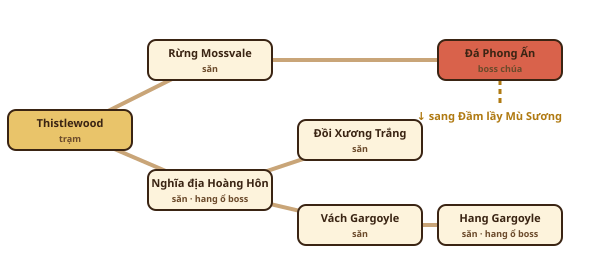

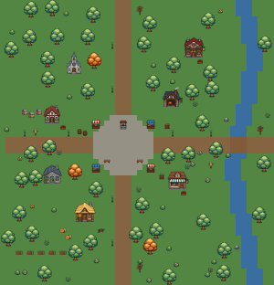 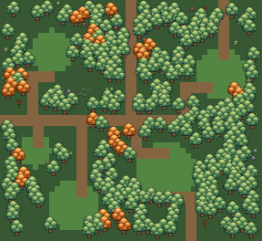 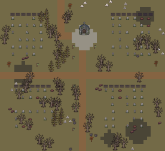 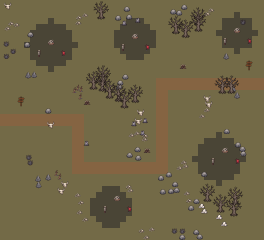 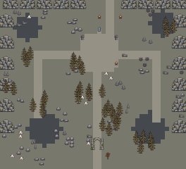 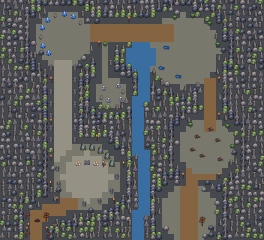 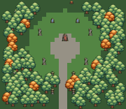 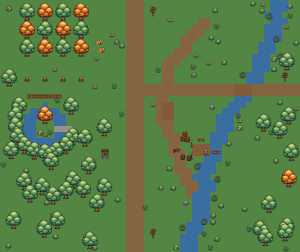 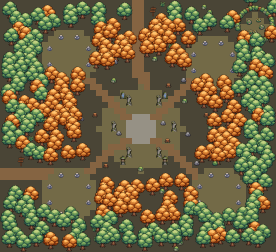 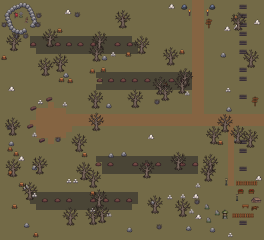 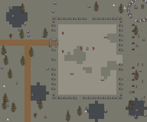 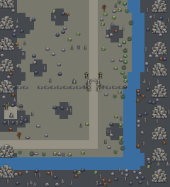

### Vùng 2 · Đầm lầy Mù Sương — Mốc 1

- Cấp 10–20 · hệ vùng Thuỷ / độc · quái yếu Thổ, Phong · Chưa có map
- Nơi ở (làng): **Làng nhà sàn Lau Xám** — Dân đầm lầy sống trên nhà sàn, nhờ người lạ dẹp quái và tìm thuốc giải độc.

| Map | Loại | Quái / boss | Hình | Map |
|---|---|---|---|---|
| Làng nhà sàn Lau Xám | Trạm | — (NPC dịch vụ) | — | chưa có |
| Bãi Lau Sậy | Săn | Ếch độc | **vẽ mới** | chưa có |
| Kênh Đỉa | Săn | Đỉa đầm | **vẽ mới** | chưa có |
|  |  | Mẹ Ếch · boss khu | **vẽ mới** |  |
| Rừng Ngập Nấm | Săn | Nấm phát quang | **vẽ mới** | chưa có |
| Đầm Rắn Nước | Săn | Rắn nước | **vẽ mới** | chưa có |
| Vực Sương Xanh | Săn | Người cá bùn | **vẽ mới** | chưa có |
|  |  | Phù thuỷ đầm · boss khu | **vẽ mới** |  |
| Hồ Hydra | Thánh địa | Hydra bùn · boss chúa | **vẽ mới** | chưa có |

Sơ đồ nối 7 map + phác thảo (bố cục để duyệt, không phải hình trong game):

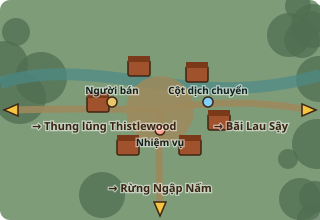 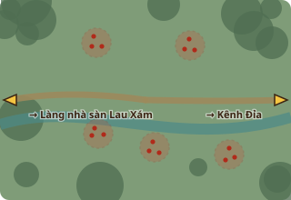 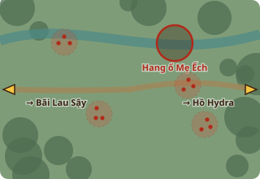 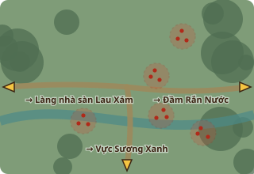 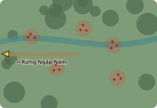 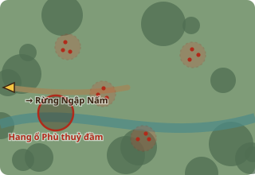 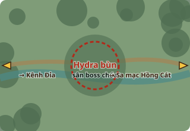

### Vùng 3 · Sa mạc Hồng Cát — Mốc 1

- Cấp 20–30 · hệ vùng Thổ / Hoả · quái yếu Thuỷ, Băng · Chưa có map
- Nơi ở (toà thành): **Thành ốc đảo Sahrin** — Vương quốc sa mạc: các tộc tranh nguồn nước, triều đình giao nhiệm vụ.

| Map | Loại | Quái / boss | Hình | Map |
|---|---|---|---|---|
| Thành ốc đảo Sahrin | Trạm (toà thành) | — (NPC dịch vụ) | — | chưa có |
| Cồn Cát Đỏ | Săn | Bọ cạp | **vẽ mới** | chưa có |
| Hẻm Rắn | Săn | Rắn cát | **vẽ mới** | chưa có |
|  |  | Bọ cạp chúa · boss khu | **vẽ mới** |  |
| Lăng Mộ Cát | Săn | Xác ướp | **vẽ mới** | chưa có |
| Vách Kền Kền | Săn | Kền kền | **vẽ mới** | chưa có |
| Phế tích Đá Đỏ | Săn | Linh hồn cát | **vẽ mới** | chưa có |
|  |  | Pharaoh xác ướp · boss khu | **vẽ mới** |  |
| Hố Cát Nuốt | Thánh địa | Sâu cát khổng lồ · boss chúa | **vẽ mới** | chưa có |

Sơ đồ nối 7 map + phác thảo (bố cục để duyệt, không phải hình trong game):

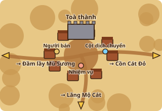 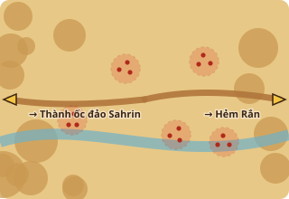 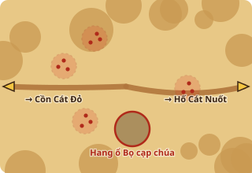 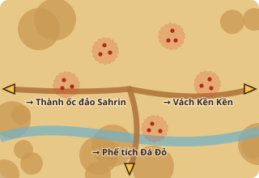 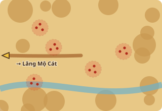 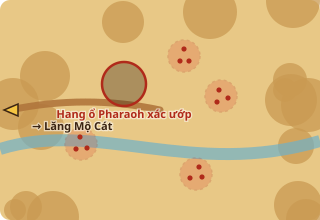 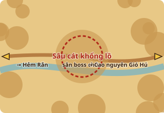

### Vùng 4 · Cao nguyên Gió Hú — Mốc 1

- Cấp 30–40 · hệ vùng Phong · quái yếu Thổ · Chưa có map
- Nơi ở (làng): **Làng Cối Xay Gió** — Làng trên cao nguyên, giữ đền thờ trên mây.
- Thêm: **Phong Long** ở Long Huyệt (map phụ của vùng)

| Map | Loại | Quái / boss | Hình | Map |
|---|---|---|---|---|
| Làng Cối Xay Gió | Trạm | — (NPC dịch vụ) | — | chưa có |
| Đồi Cỏ Cao | Săn | Sói gió | **vẽ mới** | chưa có |
| Vách Chim Ưng | Săn | Chim ưng | **vẽ mới** | chưa có |
|  |  | Đại bàng bão · boss khu | **vẽ mới** |  |
| Thung Lũng Tiên | Săn | Tiên gió | **vẽ mới** | chưa có |
| Bãi Đá Bay | Săn | Đá bay | **vẽ mới** | chưa có |
| Đường Lên Đền Mây | Săn | Yêu tinh gió | **vẽ mới** | chưa có |
|  |  | Pháp sư gió · boss khu | **vẽ mới** |  |
| Đền Trên Mây | Thánh địa | Rồng gió · boss chúa | **vẽ mới** | chưa có |

Sơ đồ nối 7 map + phác thảo (bố cục để duyệt, không phải hình trong game):

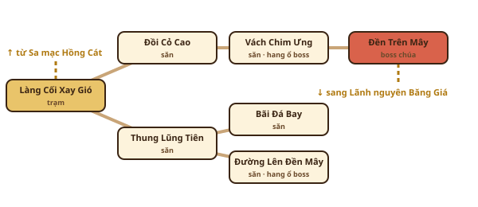

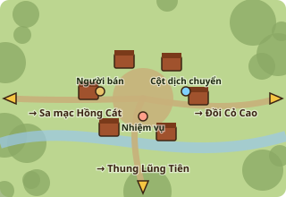 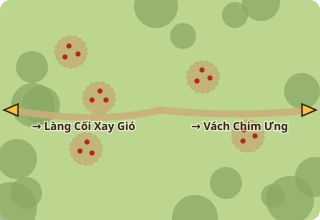 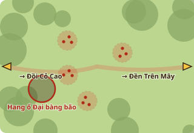 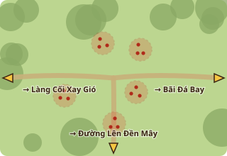 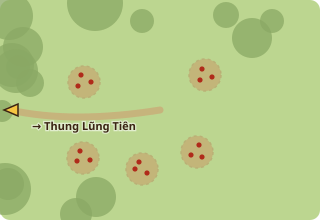 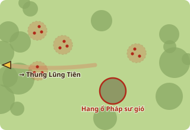 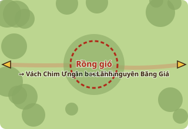

### Vùng 5 · Lãnh nguyên Băng Giá — Mốc 2

- Cấp 40–50 · hệ vùng Băng · quái yếu Hoả · Chưa có map
- Nơi ở (làng): **Làng gỗ Tuyết Phong** — Thợ săn và thợ mỏ băng sống qua mùa đông dài.
- Thêm: **Băng Long** ở Long Huyệt (map phụ của vùng)

| Map | Loại | Quái / boss | Hình | Map |
|---|---|---|---|---|
| Làng gỗ Tuyết Phong | Trạm | — (NPC dịch vụ) | — | chưa có |
| Rừng Thông Tuyết | Săn | Sói tuyết | **vẽ mới** | chưa có |
| Hồ Băng | Săn | Tinh linh băng | **vẽ mới** | chưa có |
|  |  | Nữ hoàng băng · boss khu | **vẽ mới** |  |
| Đèo Người Tuyết | Săn | Người tuyết | **vẽ mới** | chưa có |
|  |  | Yeti · boss khu | **vẽ mới** |  |
| Bờ Biển Băng | Săn | Chim cánh cụt chiến | **vẽ mới** | chưa có |
| Hang Gấu | Săn | Gấu băng | **vẽ mới** | chưa có |
| Ngai Băng | Thánh địa | Băng long · boss chúa | **vẽ mới** | chưa có |

Sơ đồ nối 7 map + phác thảo (bố cục để duyệt, không phải hình trong game):

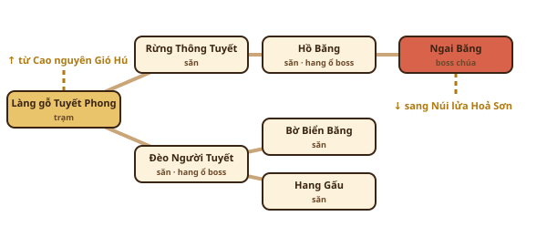

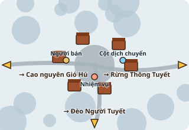 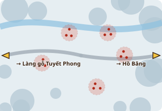 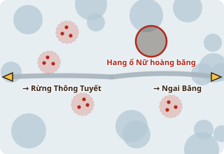 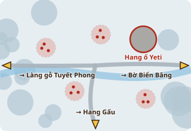 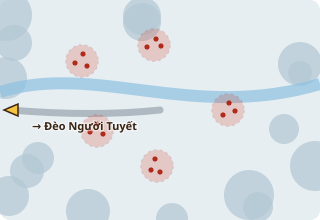 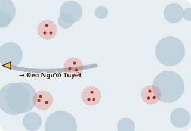 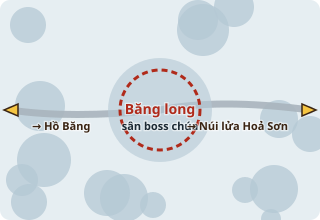

### Vùng 6 · Núi lửa Hoả Sơn — Mốc 2

- Cấp 50–60 · hệ vùng Hoả · quái yếu Thuỷ, Băng · Chưa có map
- Nơi ở (toà thành): **Pháo đài người lùn Đe Đỏ** — Hội đồng người lùn: rèn binh khí, đổi lấy nhiệm vụ trong lòng núi.
- Thêm: **Hoả Long** ở Long Huyệt (map phụ của vùng)

| Map | Loại | Quái / boss | Hình | Map |
|---|---|---|---|---|
| Pháo đài Đe Đỏ | Trạm (toà thành) | — (NPC dịch vụ) | — | chưa có |
| Bãi Đá Đen | Săn | Thằn lằn lửa | **vẽ mới** | chưa có |
| Sông Dung Nham | Săn | Golem dung nham | **vẽ mới** | chưa có |
|  |  | Golem dung nham cổ · boss khu | **vẽ mới** |  |
| Hang Dơi Lửa | Săn | Dơi lửa | **vẽ mới** | chưa có |
| Lò Rèn Bỏ Hoang | Săn | Tinh linh lửa | **vẽ mới** | chưa có |
| Miệng Núi | Săn | Quỷ lửa | **vẽ mới** | chưa có |
|  |  | Salamander · boss khu | **vẽ mới** |  |
| Lõi Núi Lửa | Thánh địa | Hoả thần · boss chúa | **vẽ mới** | chưa có |

Sơ đồ nối 7 map + phác thảo (bố cục để duyệt, không phải hình trong game):

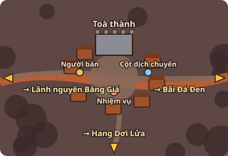 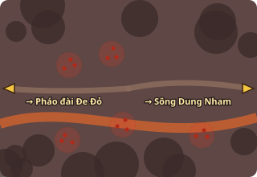 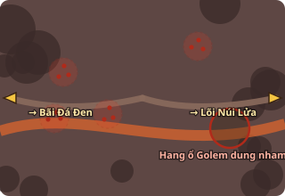 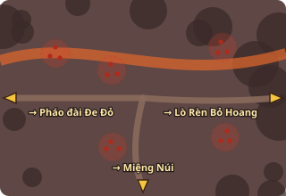 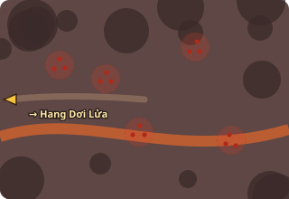 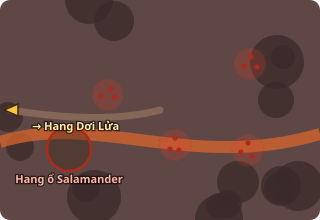 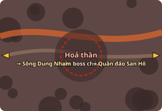

### Vùng 7 · Quần đảo San Hô — Mốc 2

- Cấp 60–70 · hệ vùng Thuỷ · quái yếu Phong, Thổ · Chưa có map
- Nơi ở (làng): **Cảng chài San Hô** — Làng chài và thương thuyền, tin đồn về tàu ma.
- Thêm: **Thuỷ Long** ở Long Huyệt (map phụ của vùng)

| Map | Loại | Quái / boss | Hình | Map |
|---|---|---|---|---|
| Cảng chài San Hô | Trạm | — (NPC dịch vụ) | — | chưa có |
| Bãi Cát Trắng | Săn | Cua | **vẽ mới** | chưa có |
| Rạn San Hô | Săn | Sứa | **vẽ mới** | chưa có |
|  |  | Cua chúa · boss khu | **vẽ mới** |  |
| Đảo Cướp Biển | Săn | Cướp biển | **vẽ mới** | chưa có |
| Đầm Người Cá | Săn | Người cá | **vẽ mới** | chưa có |
| Bãi Tàu Đắm | Săn | Bạch tuộc | **vẽ mới** | chưa có |
|  |  | Thuyền trưởng ma · boss khu | **vẽ mới** |  |
| Vực Kraken | Thánh địa | Kraken · boss chúa | **vẽ mới** | chưa có |

Sơ đồ nối 7 map + phác thảo (bố cục để duyệt, không phải hình trong game):

      

### Vùng 8 · Rừng Nấm Ngầm — Mốc 3

- Cấp 70–80 · hệ vùng Thổ · quái yếu Phong · Chưa có map
- Nơi ở (làng): **Làng người nấm Ánh Tím** — Tộc người nấm dưới lòng đất, chỉ tin người đã giúp họ.
- Thêm: **Địa Long** ở Long Huyệt (map phụ của vùng)

| Map | Loại | Quái / boss | Hình | Map |
|---|---|---|---|---|
| Làng người nấm Ánh Tím | Trạm | — (NPC dịch vụ) | — | chưa có |
| Rừng Nấm Khổng Lồ | Săn | Người nấm | **vẽ mới** | chưa có |
| Hang Nhện | Săn | Nhện hang | **vẽ mới** | chưa có |
|  |  | Nhện chúa · boss khu | **vẽ mới** |  |
| Mạch Tinh Thể | Săn | Sâu tinh thể | **vẽ mới** | chưa có |
| Hang Bọ Đèn | Săn | Bọ đèn ngầm | **vẽ mới** | chưa có |
| Điện Nấm | Săn | Rùa đá rêu | **vẽ mới** | chưa có |
|  |  | Vua người nấm · boss khu | **vẽ mới** |  |
| Lòng Đất Sâu | Thánh địa | Rồng đất · boss chúa | **vẽ mới** | chưa có |

Sơ đồ nối 7 map + phác thảo (bố cục để duyệt, không phải hình trong game):

      

### Vùng 9 · Phế tích Aether — Mốc 3

- Cấp 80–90 · hệ vùng Aether / thép (kháng phép) · quái yếu Kiếm · Chưa có map
- Nơi ở (toà thành): **Toà thành Aether cổ** — Tàn dư triều đình pháp sư xưa — các phe tranh nhau di sản Aether.
- Thêm: **Quang Long** ở Long Huyệt (map phụ của vùng)

| Map | Loại | Quái / boss | Hình | Map |
|---|---|---|---|---|
| Toà thành Aether cổ | Trạm (toà thành) | — (NPC dịch vụ) | — | chưa có |
| Phố Đổ Nát | Săn | Hiệp sĩ ma | **vẽ mới** | chưa có |
| Xưởng Máy Cổ | Săn | Vệ binh máy | **vẽ mới** | chưa có |
|  |  | Cỗ máy canh giữ · boss khu | **vẽ mới** |  |
| Thư Viện Bay | Săn | Sách bay | **vẽ mới** | chưa có |
| Tháp Pháp Sư | Săn | Pháp sư mất trí | **vẽ mới** | chưa có |
| Xưởng Rối | Săn | Rối gỗ ma thuật | **vẽ mới** | chưa có |
|  |  | Hiệp sĩ đầu lâu · boss khu | **vẽ mới** |  |
| Điện Aether | Thánh địa | Đại pháp sư sa đoạ · boss chúa | **vẽ mới** | chưa có |

Sơ đồ nối 7 map + phác thảo (bố cục để duyệt, không phải hình trong game):

      

### Vùng 10 · Vực Hư Không — Mốc 3

- Cấp 90–100 · hệ vùng Bóng tối / hỗn hợp · quái yếu Aether, Hoả · Chưa có map
- Nơi ở (toà thành): **Thành trì Hư Không** — Tiền đồn cuối cùng trước Ma vương — liên quân các vùng đóng ở đây.
- Thêm: **Hắc Long** ở Long Huyệt (map phụ của vùng)

| Map | Loại | Quái / boss | Hình | Map |
|---|---|---|---|---|
| Thành trì Hư Không | Trạm (toà thành) | — (NPC dịch vụ) | — | chưa có |
| Đảo Trôi Tím | Săn | Quỷ hư không | **vẽ mới** | chưa có |
| Khe Nứt | Săn | Mắt bay | **vẽ mới** | chưa có |
|  |  | Hiệp sĩ hư không · boss khu | **vẽ mới** |  |
| Rừng Bóng | Săn | Bóng người | **vẽ mới** | chưa có |
| Nghĩa Trang Hư Không | Săn | Ác linh | **vẽ mới** | chưa có |
| Hang Ma Sói | Săn | Ma sói | **vẽ mới** | chưa có |
|  |  | Mẹ quỷ · boss khu | **vẽ mới** |  |
| Ngai Ma Vương | Thánh địa | Ma vương · boss chúa (trùm cuối) | **vẽ mới** | chưa có |

Sơ đồ nối 7 map + phác thảo (bố cục để duyệt, không phải hình trong game):

      

## 7 rồng nguyên tố

Boss thêm ngoài 3 boss vùng; map phụ Long Huyệt, cần cấp 40; chỉ người đánh đòn cuối nhận Long Châu (mở tuyệt kỹ mốc 10); đủ 7 Long
Châu triệu hồi Thần Long. Chi tiết cơ chế: `docs/ke-hoach-the-gioi.md` mục 2.1.

| Rồng | Tên riêng | Long Huyệt | Cấp | Hệ | Chiêu chính |
|---|---|---|---|---|---|
| Phong Long | Tuyệt Vân | Vùng 4 · đỉnh Đền Trên Mây | ~40 | Phong — yếu Thổ | bay vòng trên cao, đáp xuống tạo lốc; bão gió đẩy ra mép vực |
| Băng Long | Hàn Sương | Vùng 5 · hang băng dưới hồ đóng băng | ~50 | Băng — yếu Hoả | hơi thở băng, mưa trụ băng, mặt hồ nứt |
| Hoả Long | Viêm Đế | Vùng 6 · miệng núi lửa | ~60 | Hoả — yếu Thuỷ, Băng | phun lửa theo nón, mưa thiên thạch, dung nham dâng |
| Thuỷ Long | Thương Hải | Vùng 7 · xoáy nước giữa rạn san hô | ~70 | Thuỷ — yếu Phong, Thổ | lặn / trồi chỗ khác, sóng thần, làm ướt cả sân |
| Địa Long | Thạch Cốt | Vùng 8 · đáy hang tinh thể | ~80 | Thổ — yếu Phong | trồi lên dưới chân, gai đá, giáp đá phải phá |
| Quang Long | Thiên Huy | Vùng 9 · tháp ma pháp đổ nát | ~90 | Aether — kháng phép, yếu Kiếm | tia sáng quét, khiên phản phép, nhân bản ảnh rồng |
| Hắc Long | Vô Tận | Vùng 10 · khe nứt trước cổng thành Ma vương | ~95 | Hắc ám — yếu Aether, Hoả | hố hư không hút người chơi, bóng rồng tách làm ba |

## Cần chốt

1. Mốc 1 = skill nhân vật chi tiết (23 động tác, 37 skill vẽ lại hình riêng, 8 tuyệt kỹ, 17 hiệu ứng phụ) + vùng 1–4. Danh sách động tác ở mục Skill nhân vật — thêm / bớt động tác nào?
2. Mốc 1 dùng ~2.967 lượt → gói 24$ còn dư. Đề xuất: còn lượt thì vẽ luôn Mốc 2 trong cùng gói (lượt không dùng hết trong tháng thì mất); Mốc 3 sang gói sau.
3. Tên 10 vùng, nơi ở (làng / toà thành) và tên map — tên vùng 2–10 là đề xuất. Bản phác thảo từng map ở mỗi vùng chỉ là bố cục (đường, bầy quái, hang ổ boss, lối ra) để duyệt.
4. Danh sách 46 loại quái thường (mỗi loại vẽ riêng, không dùng bản đổi màu). Đổi so với kế hoạch cũ cho khỏi trùng dáng: vùng 8 "dơi" → Bọ đèn ngầm, "golem đá" → Rùa đá rêu; vùng 9 "gargoyle cổ" → Rối gỗ ma thuật; vùng 1 thêm Dơi hang (Hang Gargoyle).
5. Chiêu: boss chúa 2 chiêu, boss khu 1 chiêu, rồng 3 chiêu (chủ dự án chốt 08/10/2026). Tên boss + chiêu chính của rồng (mục Rồng).
6. Trang bị hiện trên người + tóc làm ở Mốc 3, SAU khi động tác đã chốt (lớp đồ phải phủ mọi khung động tác). 4 kiểu hình bộ đồ cắt 4 lớp áo / quần / giày / găng, đồ gắn 24 kiểu; dây chuyền / nhẫn chỉ hiện ở kho đồ.
